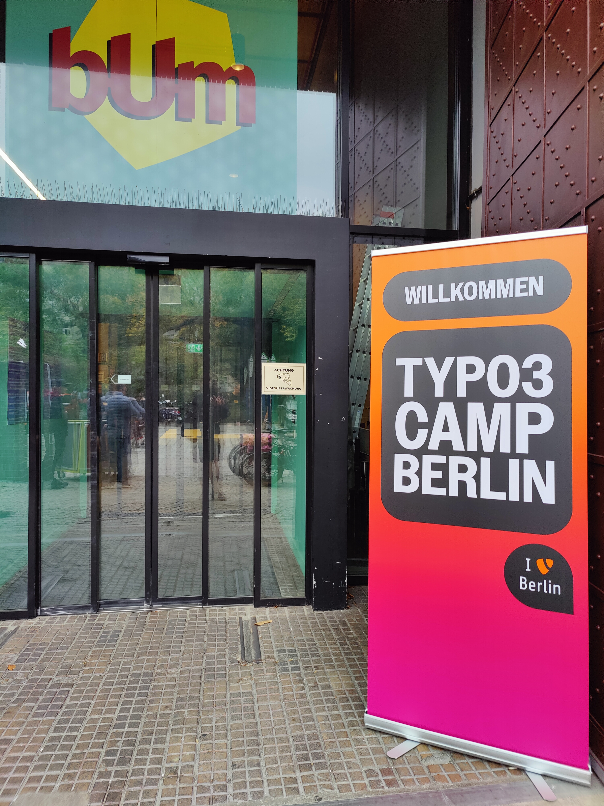
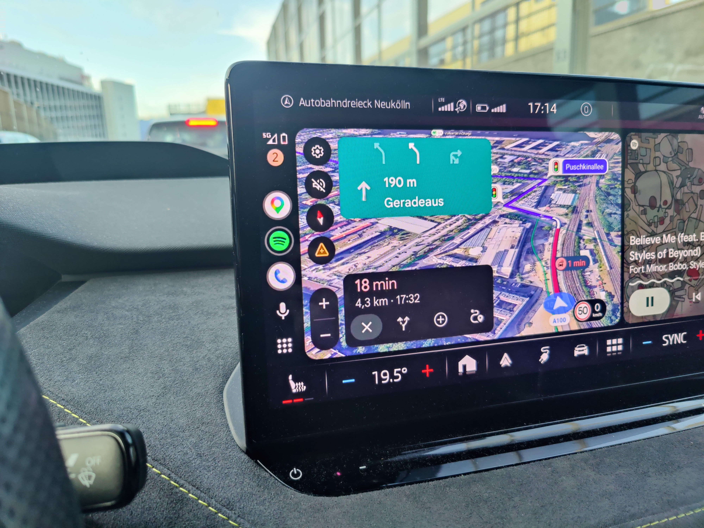
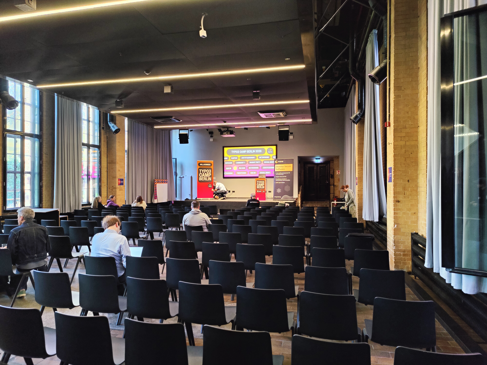
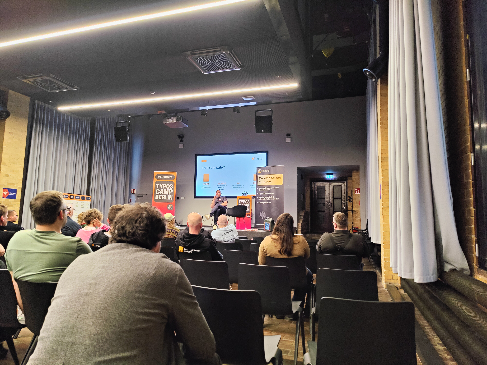
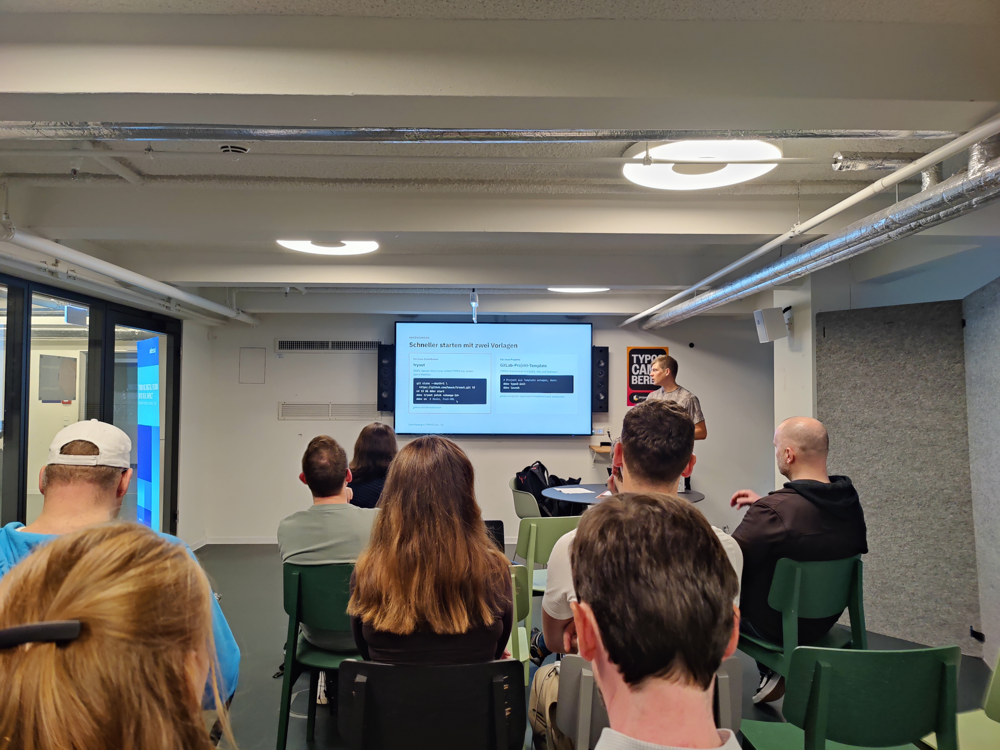
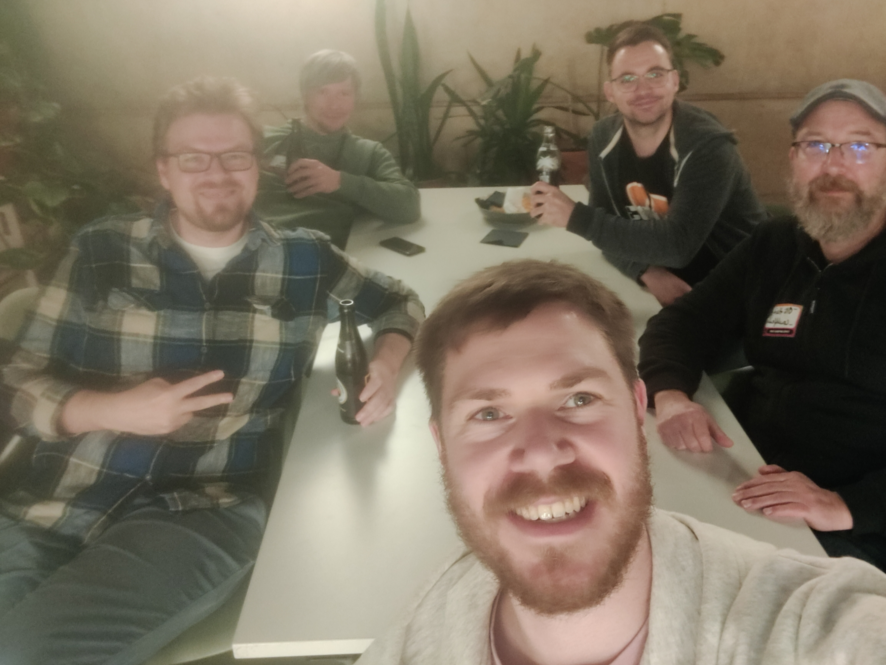

# Open Source Contribution lebt von den Menschen

Wir haben einen Montag im Oktober 2026. Das TYPO3 Camp Berlin war letzte Woche Freitag und Samstag und ich nutze diesen Blogpost zur Einordnung für das, was ich die zwei Tage dort erlebt habe. Bereits am Donnerstag machte ich mich mit drei weiteren Kollegen unserer Firma in meinem Skoda Enyaq auf den Weg und wir kamen gerade rechtzeitig genug für die Social Night an. Den Feierabendverkehr in Berlin muss man mal live erlebt haben, das war eine Lebenserfahrung und ein gutes Training für die eigene Resilienz – der Bahnfahrer aus unseren Reihen war natürlich schon längst da.

Anstatt aber auf die Social Night zu gehen, steht für mich an fremden Orten immer eines im Fokus: Die nächstgelegene Kartbahn ausprobieren. So trug es sich zu, dass ich auf der Social Night mit Helm und Sportoutfit erschienen bin. Durch das eine oder andere Gespräch dort vor Ort hat sich für mich bestätigt, was ich ohnehin vorhatte: Mit der Erfahrung der Devdays im Rücken wollte ich mich dieses Mal bewusst in die kleinen Räume reinsetzen. Frontalvorträge mit großem Publikum sind schön und gut, aber ich möchte den Interaktionen von anderen Menschen beiwohnen und selber in den Austausch treten. Freitagmorgen ging es also rein in die kurze Hose, der Avicii-Pullover wurde noch schnell drübergezogen und los ging es. Oh boy, ich hatte sowas von keine Ahnung, was mich die zwei Tage erwarten wird. Damit du verstehst, warum mich dieses Camp so bewegt hat, brauchst du vorab ein wenig Kontext zu mir als Person:

## Wer ich bin und was ich mache

Ich sehe mich selber als "Mädchen für alles" rund um das Umsetzbare in TYPO3, schließlich beschäftige ich mich in unseren Projekten seit 11+3 Jahren damit. Damals in den 4.5er- und 6.2er-Instanzen war TemplaVoila der heiße Scheiß und TypoScript war für das Menü-Rendering essenziell wichtig. Ich habe demzufolge in unseren Kundenprojekten viel gesehen und umgesetzt, mein Kernpotenzial ist die Extension-Entwicklung. Frontend kann ich zwar auch, verglichen mit PHP sind meine Stärken im JS aber eher rudimentär. Jenseits des Programmierens bekleide ich mittlerweile in meinem Team die Rolle des SDM, gestalte die internen Prozesse für mich und die Jungs aktiv mit und bin generell zu jemandem avanciert, dessen Rat man oft einholt. So ein Mist, das war nie mein Plan – aber so ist das halt, plötzlich wird man für andere wichtig. :)

## Der Beginn der Klimax: Freitag bis 15:59 Uhr

Nach dem Vortragspitching startete der Freitag für mich mit dem **Speed Dating**: Man saß man auf einem Drehstuhl mittig im Kreis der Teilnehmenden und musste 60 Sekunden etwas über sich erzählen und 60 Sekunden Fragen zu sich selber beantworten. Gar nicht so leicht, sich selber auf eine Minute zu komprimieren. Im nächsten Talk **Bereitstellung von APIs** ging es um Fachbezogenes und thematisch darum, Inhalte aus dem TYPO3 für andere Systeme bereitzustellen; Stichwort Headless. Dann wurde es langsam spannend: Ich saß im **TYPO3 Kummerkasten**, in dem wir Tom Maroschik und Luisa Faßbender berichten konnten, wo unsere Schmerzen aus dem Kosmos TYPO3 liegen. Alles, was von uns Klagenden ausgesprochen wurde, waren konkret anfassbare Probleme, zu denen uns entweder konkrete Tipps gegeben worden sind, wie wir die Dinge korrekt adressieren, oder die direkt von einem der beiden mitgenommen wurden.

## Und Abfahrt: Freitag ab 16:00 Uhr
Dann startete die Gesprächsrunde zum Thema **T3 Governance** von Christoph Laubach. Im Pitch am Vormittag klang das interessant, da wollte ich stilles Mäuschen spielen. Ich hab ja einiges gehört über einen offenen Brief und die Dialogue Days, die Puzzlestücke konnte ich aber noch nicht zu einem Gesamtbild zusammenfügen und es hat mich auch wenig gekümmert. Plötzlich finde ich mich also in einem Raum mit 20 anderen Personen wieder: Geschäftsführern, Community-Größen und aktiven Contributoren. "You probably wonder how i got here" habe ich nicht nur einmal gedacht. Und es wurde diskutiert: Über Kommunikation, Flurfunk und die Art, wie Dinge sich in der TYPO3-Community herumsprechen oder eben auch insbesondere nicht herumsprechen. Über fehlende Contribution und wo das herkommen mag zum einen, zum anderen aber auch über die Unsicherheit ob der Umstrukturierung von den TYPO3 Teams hin zu den Units und was das für die unverbindliche Beteiligung an unserem Open Source Projekt bedeutet. Es war ein Abgleich unterschiedlicher Wissensstände gepaart mit unterschiedlichen Auffassungen, die in diesem kleinen Raum miteinander kollidierten. Mitten drin saß ich, der seine Meinung kund tat und sich damit ernst genommen fühlte. Als dann die Stunde Zeit für die Gesprächsrunde abgelaufen war und wir den Raum frei machen mussten, waren nicht nur bei mir noch viele Fragen offen. So kam es, dass wir in einer kleineren Gruppe bis 19:00 Uhr weiter diskutierten und uns austauschten.

## Der Tag danach: Samstag

Mich hat diese Gesprächsrunde und all die Themen gefesselt. Mir war also klar, dass es Samstag für mich genau damit weitergeht. Nach dem Talk **Abrechnung, Verdienst in Zeiten von KI & CRA**, der an sich fachlich spannend für unser Tätigkeitsfeld ist, war mir persönlich **TYPO3 Governance (Units, Satzungsänderung)** geleitet von Jana Höffner und Martin Helmich wichtig. Und was soll ich sagen: Es knüpfte 1:1 an den vergangenen Tag an, diesmal hauptsächlich mit dem Fokus auf die geplante organisatorische Umstrukturierung der TYPO3 Teams. Es wurde ein Stück emotionaler geführt als die Freitags-Gesprächsrunde, obgleich der Teilnehmerkreis interessenbedingt sehr ähnlich war. Daran gliederte sich der Talk **Quo Vadis, TYPO3** geleitet von Daniel Fau als folgerichtig nächster Baustein, bei dem es primär um den Teilaspekt der Finanzierung des TYPO3-Projekts im Generellen und um die Suite im Speziellen ging. Zu der Suite, die von der TYPO3 GmbH entwickelt wird, gibt es die kommenden Tage ein (er)klärendes Paper – wir sind gespannt.

Damit nicht genug: Der letzte Talk des Camps für mich war **Code Contribution in den Core** von Oli Bartsch. Auch hier ging es in Teilen um die neue Struktur, dass die TYPO3 Teams durch die sogenannten Units abgelöst werden und es ist entsprechend in seine Folien bereits eingeflossen. Viel wichtiger aber war, dass man eine sehr gute Anleitung dafür bekommen hat, wie man aktiv in die Tasten haut, um den Code von TYPO3 zu verbessern.

## Contribution muss von allen kommen

Das TYPO3 Camp Berlin stand für mich ganz im Zeichen der Teilhabe an TYPO3. Etwas, das ich vorher so nicht erwartet hätte, denn schließlich bin ich fernab davon, in der Community aktiv zu sein. Mal sehen, ob sich das nun ändert – ein Funke ist jedenfalls auf mich übergesprungen. Immerhin habe ich am Freitagabend meine Community-Membership klargemacht und einige Kollegen konnte ich ebenfalls dafür begeistern. Wir bekommen von Leuchtfeuer die Zeit, uns aktiv in die Community einzubringen – insofern wird die Zukunft zeigen, inwiefern aus ebenjenem Funken ein Feuer wird.

